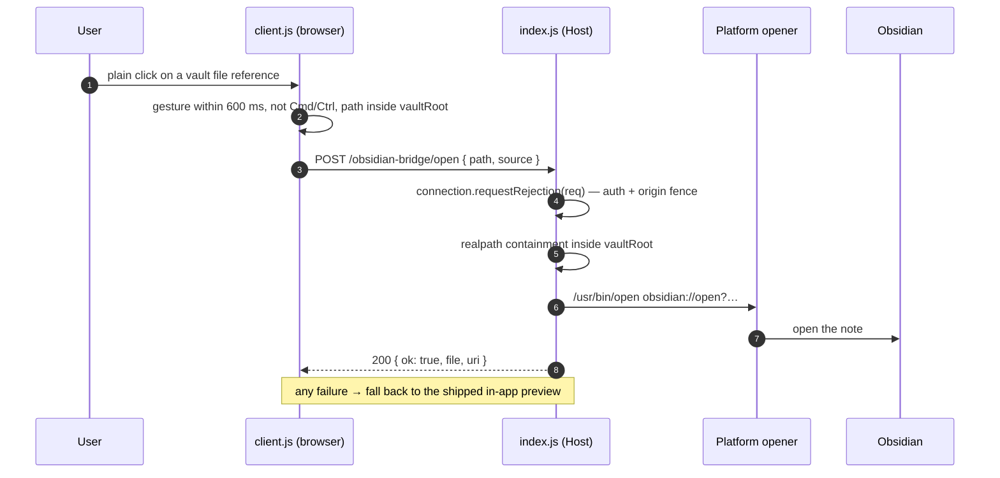

# dsh-obsidian-bridge

[](https://github.com/Wang-Chuming/dsh-obsidian-bridge/actions/workflows/ci.yml)
[](LICENSE)
[](package.json)

An **Obsidian channel for the [DeepSeek Harness](https://github.com/deepseek-ai/deepseek-harness) Web GUI**:
click a file that lives in your Obsidian vault — in the conversation, in a tool output, in a
file mention, in the file tree — and it opens **in Obsidian**, not in the in-app preview.

> 中文说明见 [README.zh-CN.md](README.zh-CN.md)。

The Harness Web GUI ships a good in-app preview. But when your notes are an Obsidian vault,
the preview is the wrong destination: you want backlinks, the graph, your plugins, your
themes. This plugin installs a one-way channel from the conversation to the Obsidian app
and leaves everything else — Cmd/Ctrl-click, files outside the vault, programmatic opens —
exactly as the Harness shipped it.

## What it does

| Gesture | Result |
| --- | --- |
| **Plain click** on a vault file reference (Markdown file links in the conversation, tool-row paths, inline file mentions, `@file` references, vault files in the file tree) | Opens in Obsidian via `obsidian://open`, Obsidian comes to the front |
| **Cmd/Ctrl + click** | The Harness in-app document preview (unchanged) |
| Files outside `vaultRoot`, extensions not in `extensions`, programmatic or restore-time opens | The Harness in-app document preview (unchanged) |
| “Open this note for me” | The `open_in_obsidian` model tool, same operation as a click |

## How it works



Two halves, one package:

- **Host half — `index.js`.** Registers three authenticated routes on the Harness web server
  and the `open_in_obsidian` model tool. Every open goes through one function: resolve the
  requested path inside `vaultRoot` (`realpath` + `path.relative`, so `..` and symlinks that
  leave the vault are refused), build an `obsidian://` URI, launch the platform opener with
  an argument vector (never a shell string).
- **Client half — `client.js`.** Wraps `ctx.sidebarRight.openResource`, the single navigation
  controller every file-open path in the Web GUI goes through. A plain click on a vault file
  is redirected to the host route; Cmd/Ctrl-click and everything that is not a vault hit fall
  through to the original controller. A first-load self-test exercises the whole chain once
  and writes the result to a JSONL diagnostic log.

### The routes

| Route | Method | Purpose |
| --- | --- | --- |
| `/obsidian-bridge/config` | `GET` | Vault configuration for the client half (`vaultRoot`, `vaultName`, `extensions`, `testPath`, `selftest`, `configFile`, `ok`) |
| `/obsidian-bridge/open` | `POST` | `{ path, source? }` → open one vault file; `200` on success, `422` with an error otherwise |
| `/obsidian-bridge/diag` | `POST` | Append one diagnostic line from the browser |

All three ask `ctx.connection.requestRejection(req)` first. That reuses the Harness Host/Origin
fence (DNS-rebinding and cross-site protection) and the browser login cookie. If the connection
service is absent the bridge answers **503** instead of serving — it fails closed.

### Where the configuration comes from

The Host half resolves its settings once at startup, in this order:

1. the bundle row's `config:` block (the packaged `cordis.patch.yml` ships without one);
2. `~/.dsh/obsidian-bridge.config.json` — the recommended place for your vault path;
3. the defaults in the table below.

With no `vaultRoot` from either source the plugin loads but stays **inert**: the config route
answers `ok: false` and the client keeps the shipped in-app preview for every file.

## Requirements

- DeepSeek Harness with the Web GUI and plugin-bundle support (the plugin is a bundle layer:
  a Host row plus its client half).
- Obsidian installed, with the vault you want to bridge to.
- Node.js ≥ 20 only for running the tests; at runtime the plugin lives inside the Harness and
  imports **nothing but Node built-ins**.

Developed and tested on macOS. The Windows (`cmd /c start`) and Linux (`xdg-open`) openers are
implemented but less exercised — issues and patches welcome.

## Install

### 1. Add the plugin to your profile

```bash
dsh plugin --profile <profile> add github:Wang-Chuming/dsh-obsidian-bridge
```

`<profile>` is `desktop`, `web`, or `headless`. The command installs the package and, because
the package declares `dsh.bundle`, adds it to `dsh.profile.bundles` automatically. On the
Desktop app you can instead install it through **Settings → Plugins** (or the Plugin Market
once the plugin is listed), which manages the Desktop profile for you.

### 2. Point it at your vault

```bash
cat > ~/.dsh/obsidian-bridge.config.json <<'JSON'
{
  "vaultRoot": "/Users/you/Research/Research-Vault",
  "vaultName": "Research-Vault",
  "extensions": [".md", ".canvas", ".base"]
}
JSON
```

`vaultRoot` is the only required field; `~` is expanded in every path. A missing or malformed
file simply means “no overrides” — the plugin then stays inert instead of guessing.

### 3. Restart and confirm the channel

Restart the Harness (a client-only reload is not enough: the Host half reads the config and
registers routes and the model tool at startup). After the first page load,
`~/.dsh/obsidian-bridge.diag.jsonl` should contain roughly:

```json
{"event":"host-activate","vaultRoot":"/path/to/your/vault","extensions":[".md"],"selftest":true,"configFile":"/Users/you/.dsh/obsidian-bridge.config.json"}
{"client":true,"wrapped":true,"hasSessions":true,"event":"client-activate"}
{"client":true,"ok":true,"vaultRoot":"/path/to/your/vault","event":"client-config"}
{"event":"selftest-trigger","path":"/path/to/your/vault/HOME.md"}
{"event":"open","source":"selftest","ok":true, …}
```

Then plain-click any vault note link in the conversation: it opens in Obsidian. Cmd/Ctrl-click
the same link: the in-app preview opens.

### Development install (clone + link)

For working on the plugin itself, link a checkout instead:

```bash
git clone https://github.com/Wang-Chuming/dsh-obsidian-bridge.git ~/dsh-obsidian-bridge
```

Add `"@dsh-external/dsh-obsidian-bridge": "link:/Users/you/dsh-obsidian-bridge"` to the profile's
`dependencies`, add `@dsh-external/dsh-obsidian-bridge` to `dsh.profile.bundles`, run
`pnpm install` in `~/.dsh/profiles/<profile>`, and restart. The row `name` in
`cordis.patch.yml` must match the dependency name.

## Configuration

Recommended: `~/.dsh/obsidian-bridge.config.json`.

| Field | Default | Meaning |
| --- | --- | --- |
| `vaultRoot` | *(required)* | Absolute path of the Obsidian vault (`~` allowed). Empty ⇒ the bridge loads but stays inert. |
| `vaultName` | `''` | Vault name as Obsidian shows it. Empty ⇒ `obsidian://open?path=…` instead of `?vault=…&file=…`. |
| `extensions` | `['.md']` | Which vault files are taken away from the in-app preview. Empty array ⇒ every vault file. |
| `testPath` | `HOME.md` | Target of the first-load self-test, relative to `vaultRoot`. |
| `selftest` | `true` | Run the end-to-end self-test once per browser (it opens Obsidian once). |
| `diagFile` | `~/.dsh/obsidian-bridge.diag.jsonl` | JSONL diagnostic log. |
| `configFile` | `~/.dsh/obsidian-bridge.config.json` | Where the JSON config is read from. Can also be set with the `DSH_OBSIDIAN_BRIDGE_CONFIG` environment variable. |

The bundle row's own `config:` block wins over the JSON file field by field; the packaged
`cordis.patch.yml` ships without `config:` on purpose, so plugin updates never touch your
settings. `cordis.patch.example.yml` documents the inline form, and the header of
`cordis.patch.yml` shows how a profile-level patch can override a single field.

## Security notes

- **Authenticated + origin-fenced.** The routes reuse `connection.requestRejection`; there is
  no unauthenticated path, and no CORS relaxation.
- **Containment.** A path is opened only if its `realpath` is a regular file strictly inside
  `realpath(vaultRoot)`. `..`, absolute paths outside the vault, symlinks pointing outside, and
  control characters are rejected. The model tool has no wider reach than a click.
- **No shell.** The platform opener is invoked with an argument vector (`/usr/bin/open <uri>`,
  `cmd /c start "" <uri>`, `xdg-open <uri>`); the URI is never interpolated into a shell string.
- **Diagnostics contain vault paths.** They are written to `~/.dsh/`, never to the vault or the
  repository. Delete the file, point `diagFile` elsewhere, or set `selftest: false` if you do
  not want it.
- The config file is read as data only — no `require`, no evaluation, no network access.

## Limitations

- The plugin depends on Harness-internal surfaces: the `webServer` and `connection` services,
  `ctx.sidebarRight.openResource`, the `sessions` store, and the `dsh-resource://file/…`
  resource address format. A Harness upgrade that changes these needs a matching plugin update.
- Only files **inside** the vault can be opened; Obsidian cannot open files outside a vault
  through the URI scheme.
- Only **user gestures** are redirected: an open within 600 ms of a click. Programmatic opens
  (session restore, other plugins calling `openResource`) keep the in-app preview so reloading
  the page never sprays Obsidian windows.
- The package is distributed through GitHub. The `@dsh-external` name is the author's local
  plugin namespace — this package is **not** published to npm, and the `private` flag keeps it
  that way.

## Development

```bash
npm run check   # syntax check for the host half, client half, and tests
npm test        # node --test: config precedence, path containment, URI encoding, openers
```

| Path | Role |
| --- | --- |
| `index.js` | Host half: routes, `open_in_obsidian` tool, config resolution, containment, opener |
| `client.js` | Client half: wraps `openResource`, gesture gating, self-test |
| `locale/{en,zh}.json` | Plugin Manager title/description |
| `icon.svg` | Plugin icon |
| `cordis.patch.yml` | Bundle layer shipped with the package (no user data) |
| `cordis.patch.example.yml` | Inline-config reference form |
| `test/host.test.mjs` | Node test suite for the host helpers |

The client half needs a real browser (and a running Harness) to exercise; the repository's CI
covers the host helpers only.

## Related

The DSH plugin ecosystem is large: start from
[awesome-dsh-plugin](https://github.com/awesome-dsh-plugin/awesome-dsh-plugin).
Other DSH + Obsidian plugins cover vault memory, note authoring, and draft writing; this plugin is
deliberately narrow — it never indexes, reads, or writes the vault. It only hands a click over to the
Obsidian app and lets Obsidian do the rest.

## License

[MIT](LICENSE) © 2026 Wang-Chuming
