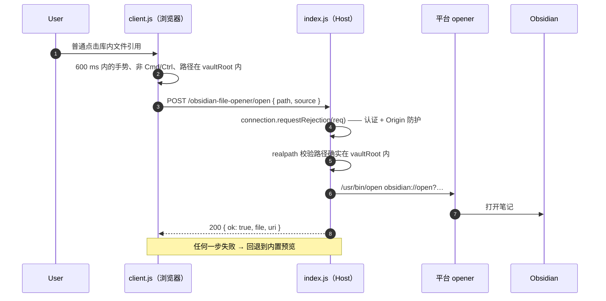

# dsh-obsidian-file-opener

**[DeepSeek Harness](https://github.com/deepseek-ai/deepseek-harness) Web GUI 的 Obsidian 文件打开器**：
点击对话里引用的 Obsidian 库内文件（聊天气泡中的 Markdown 链接、工具行路径、行内文件提及、
`@file` 引用、文件树里的库内文件），直接**在 Obsidian 中打开**，而不是在 Harness 内置预览里打开。

> English: [README.md](README.md)

Harness 自带的预览本身很好用，但当你的笔记就是一个 Obsidian 库时，预览是错误的目标——
你需要的是反链、关系图、插件和主题。这个插件只做一条单向通道：从对话到 Obsidian。
其他一切行为（Cmd/Ctrl+点击、库外文件、程序化打开）保持 Harness 原样。

## 行为

| 手势 | 结果 |
| --- | --- |
| **普通点击**库内文件引用 | 通过 `obsidian://open` 在 Obsidian 打开，Obsidian 切到前台 |
| **Cmd/Ctrl + 点击** | Harness 内置文档预览（保持原样） |
| 库外文件、`extensions` 之外的后缀、程序化/恢复时的打开 | Harness 内置文档预览（保持原样） |
| 「帮我打开这条笔记」 | 模型工具 `open_in_obsidian`，与点击走同一个打开操作 |

## 工作原理



同一个包里有两个半边：

- **Host 半边 `index.js`**：在 Harness web server 上注册三条需要认证的路由，外加
  `open_in_obsidian` 模型工具。所有打开都走同一个函数：先把请求路径解析到 `vaultRoot`
  内（`realpath` + `path.relative`，因此 `..` 和指向库外的符号链接会被拒绝），再构造
  `obsidian://` URI，最后用参数数组（绝不经过 shell 字符串）调用平台 opener。
- **Client 半边 `client.js`**：包装 `ctx.sidebarRight.openResource` —— Web GUI 里所有文件
  打开路径唯一的导航入口。普通点击库内文件时改走 Host 路由；Cmd/Ctrl+点击以及一切非库内
  命中都落回原控制器。每个浏览器首次加载时跑一次端到端自检，把结果写入 JSONL 诊断日志。

### 路由

| 路由 | 方法 | 作用 |
| --- | --- | --- |
| `/obsidian-file-opener/config` | `GET` | 返回给 Client 半边的库配置（`vaultRoot`、`vaultName`、`extensions`、`testPath`、`selftest`、`configFile`、`ok`） |
| `/obsidian-file-opener/open` | `POST` | `{ path, source? }` → 打开库内一个文件；成功 `200`，失败 `422` 并带错误 |
| `/obsidian-file-opener/diag` | `POST` | 追加一行浏览器侧诊断 |

三条路由都先调用 `ctx.connection.requestRejection(req)`：复用 Harness 的 Host/Origin 防护
（防 DNS rebinding、防跨站调用）和浏览器登录 cookie。如果该服务不存在，插件直接返回 **503**
——fail closed，不会退化成无认证接口。

### 配置从哪里来

Host 半边在启动时按下面的顺序解析一次配置：

1. bundle 行的 `config:` 块（随包发布的 `cordis.patch.yml` 故意不带 config）；
2. `~/.dsh/obsidian-file-opener.config.json` —— 推荐把库路径放这里；
3. 下表中的默认值。

两处都没有 `vaultRoot` 时插件照常加载但保持**惰性**：config 路由返回 `ok: false`，
Client 半边对所有文件都保留内置预览。

## 环境要求

- 带 Web GUI 与 plugin bundle 能力的 DeepSeek Harness（本插件是一个 bundle 层：一个 Host 行
  加它的 client 半边）。
- 已安装 Obsidian，并有一个要桥接的库。
- Node.js ≥ 20 仅用于跑测试；运行期插件跑在 Harness 里，只 import Node 内置模块，**零第三方依赖**。

主要在 macOS 上开发和验证。Windows（`cmd /c start`）与 Linux（`xdg-open`）的 opener 已实现，
但验证较少，欢迎 issue / PR。

## 安装

### 1. 把插件装进 profile

```bash
dsh plugin --profile <profile> add github:Wang-Chuming/dsh-obsidian-file-opener
```

`<profile>` 是 `desktop`、`web` 或 `headless`。该命令安装包，并因为包声明了 `dsh.bundle`
而自动把插件加进 `dsh.profile.bundles`。Desktop 应用里也可以走 **Settings → Plugins**
（或市场里一键安装）由 app 管理 Desktop 的 profile。

### 2. 指向你的库

```bash
cat > ~/.dsh/obsidian-file-opener.config.json <<'JSON'
{
  "vaultRoot": "/Users/you/Research/Research-Vault",
  "vaultName": "Research-Vault",
  "extensions": [".md", ".canvas", ".base"]
}
JSON
```

唯一必填的是 `vaultRoot`；所有路径里的 `~` 会被展开。文件不存在或格式错误只表示「没有覆盖」，
插件会保持惰性，不会乱猜。

### 3. 重启并确认

重启 Harness（只刷新页面不够：Host 半边在启动时读取配置、注册路由和模型工具）。首次加载页面后，
`~/.dsh/obsidian-file-opener.diag.jsonl` 里应出现类似记录：

```json
{"event":"host-activate","vaultRoot":"/path/to/your/vault","extensions":[".md"],"selftest":true,"configFile":"/Users/you/.dsh/obsidian-file-opener.config.json"}
{"client":true,"wrapped":true,"hasSessions":true,"event":"client-activate"}
{"client":true,"ok":true,"vaultRoot":"/path/to/your/vault","event":"client-config"}
{"event":"selftest-trigger","path":"/path/to/your/vault/HOME.md"}
{"event":"open","source":"selftest","ok":true, …}
```

然后普通点击对话里的库内笔记链接会在 Obsidian 打开；对同一链接 Cmd/Ctrl+点击仍是内置预览。

### 开发用安装（clone + link）

要改插件本身时，链接本地 checkout 更方便：

```bash
git clone https://github.com/Wang-Chuming/dsh-obsidian-file-opener.git ~/dsh-obsidian-file-opener
```

把 `"@dsh-external/dsh-obsidian-file-opener": "link:/Users/you/dsh-obsidian-file-opener"` 加进 profile 的
`dependencies`，把 `@dsh-external/dsh-obsidian-file-opener` 加进 `dsh.profile.bundles`，在
`~/.dsh/profiles/<profile>` 里 `pnpm install`，然后重启。`cordis.patch.yml` 里的行 `name`
必须与依赖名一致。

## 配置

推荐写在 `~/.dsh/obsidian-file-opener.config.json`。

| 字段 | 默认 | 含义 |
| --- | --- | --- |
| `vaultRoot` | *必填* | Obsidian 库的绝对路径（支持 `~`）。为空 ⇒ 插件加载但保持惰性。 |
| `vaultName` | `''` | Obsidian 中显示的库名。为空 ⇒ 用 `obsidian://open?path=…` 而不是 `?vault=…&file=…`。 |
| `extensions` | `['.md']` | 哪些库内文件从内置预览里被接管。空数组 ⇒ 库内全部文件。 |
| `testPath` | `HOME.md` | 首次加载自检的目标文件，相对 `vaultRoot`。 |
| `selftest` | `true` | 每个浏览器跑一次端到端自检（会打开一次 Obsidian）。 |
| `diagFile` | `~/.dsh/obsidian-file-opener.diag.jsonl` | JSONL 诊断日志路径。 |
| `configFile` | `~/.dsh/obsidian-file-opener.config.json` | JSON 配置读取位置；也可用环境变量 `DSH_OBSIDIAN_FILE_OPENER_CONFIG` 指定。 |

bundle 行自己的 `config:` 块按字段覆盖 JSON 文件；随包发布的 `cordis.patch.yml` 故意不带
`config:`，这样插件升级永远不会碰你的设置。`cordis.patch.example.yml` 记录内联写法，
`cordis.patch.yml` 头部注释展示了 profile 级 patch 覆盖单个字段的方式。

## 安全说明

- **需要认证 + Origin 防护**：路由复用 `connection.requestRejection`，没有免认证入口，也不放宽 CORS。
- **路径限制**：只有 `realpath` 落在 `realpath(vaultRoot)` 内、且是普通文件的路径才会被打开。
  `..`、库外绝对路径、指向库外的符号链接、含控制字符的路径一律拒绝。模型工具不会比点击更有权限。
- **不经过 shell**：平台 opener 一律用参数数组调用。
- **诊断日志会记录库内路径**，但只写到 `~/.dsh/`，不进库、不进仓库。不想留可删除该文件、
  改 `diagFile`，或设 `selftest: false`。
- 配置文件只当数据读：不 `require`、不 eval、不联网。

## 已知限制

- 依赖 Harness 内部接口：`webServer` / `connection` 服务、`ctx.sidebarRight.openResource`、
  `sessions` store、`dsh-resource://file/…` 资源地址格式。Harness 升级若改动这些，插件需同步更新。
- 只能打开**库内**文件：Obsidian 的 URI scheme 无法打开库外文件。
- 只接管**用户手势**触发的打开（点击后 600 ms 内）。程序化打开（会话恢复、其他插件调用
  `openResource`）保持内置预览，避免刷新页面时弹出一堆 Obsidian 窗口。
- 通过 GitHub 分发。`@dsh-external` 是作者的本地插件命名空间，**不发布到 npm**，
  `package.json` 的 `private` 字段也保证这一点。

## 开发

```bash
npm run check   # 语法检查（Host / Client / 测试）
npm test        # node --test：配置优先级、路径限制、URI 编码、平台 opener
```

| 路径 | 作用 |
| --- | --- |
| `index.js` | Host 半边：路由、`open_in_obsidian` 工具、配置解析、路径校验、平台 opener |
| `client.js` | Client 半边：包装 `openResource`、手势门控、自检 |
| `locale/{en,zh}.json` | 插件管理器里的标题与描述 |
| `icon.svg` | 插件图标 |
| `cordis.patch.yml` | 随包发布的 bundle 层（不含用户数据） |
| `cordis.patch.example.yml` | 内联配置的参考写法 |
| `test/host.test.mjs` | Host 辅助函数的 Node 测试 |

Client 半边需要真实浏览器 + 运行中的 Harness 才能验证；仓库 CI 只覆盖 Host 辅助函数。

## 相关项目

DSH 插件生态很大，可以从
[awesome-dsh-plugin](https://github.com/awesome-dsh-plugin/awesome-dsh-plugin) 开始浏览。
有几条和本插件挨得比较近，值得说明区别：

- [`dsh-open-native`](https://github.com/Lessthinker66/dsh-open-native) —— **交互上最像**：点交付文件卡片时用系统默认程序打开，Shift/Ctrl/Alt/Cmd 保留内置预览。它在 DOM 捕获阶段只拦 `[data-presented-file]` 这一种卡片，然后调 `session.openWorkspacePath`；本插件包装的是 Harness 的导航控制器 `ctx.sidebarRight.openResource`，因此**所有文件打开入口都覆盖**——对话里的 Markdown 链接、工具行路径、行内提及、`@file` 引用、文件树——并且走 `obsidian://` 而不是系统文件关联。
- [`dsh-open-with`](https://github.com/HildebrandYu/dsh-open-with) —— 按后缀配置「用哪个 app 打开」，规则存在 `~/.dsh/open-with.json`，作用于交付卡片、侧边预览和变更审查。配置文件和「指定 app」的思路相同，但它不认库：打开的是原始文件，而不是通过 `obsidian://` 打开笔记。
- [`NOOBnoob163/dsh-open-obsidian`](https://github.com/NOOBnoob163/dsh-open-obsidian) —— 第一条真人消息时自动打开整个库（仅 Windows，为的是让同步插件跑起来），并带按库写锁。触发点和目的都不同；本插件只打开被点击的那一篇笔记，从不写库。
- [`dsh-wsl-obsidian`](https://github.com/173787247/dsh-wsl-obsidian) —— WSL/Windows 下的库访问（读写工具 + `obsidian://` 打开），面向 Agent 读写笔记，而不是 Web GUI 里点击文件的行为。

本插件刻意保持窄：它不索引、不读取、不写入你的库，只把一次点击交给 Obsidian，剩下的交给 Obsidian 自己。

## 许可证

[MIT](LICENSE) © 2026 Wang-Chuming
